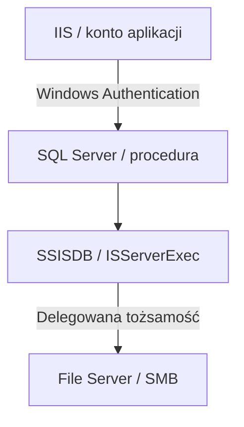
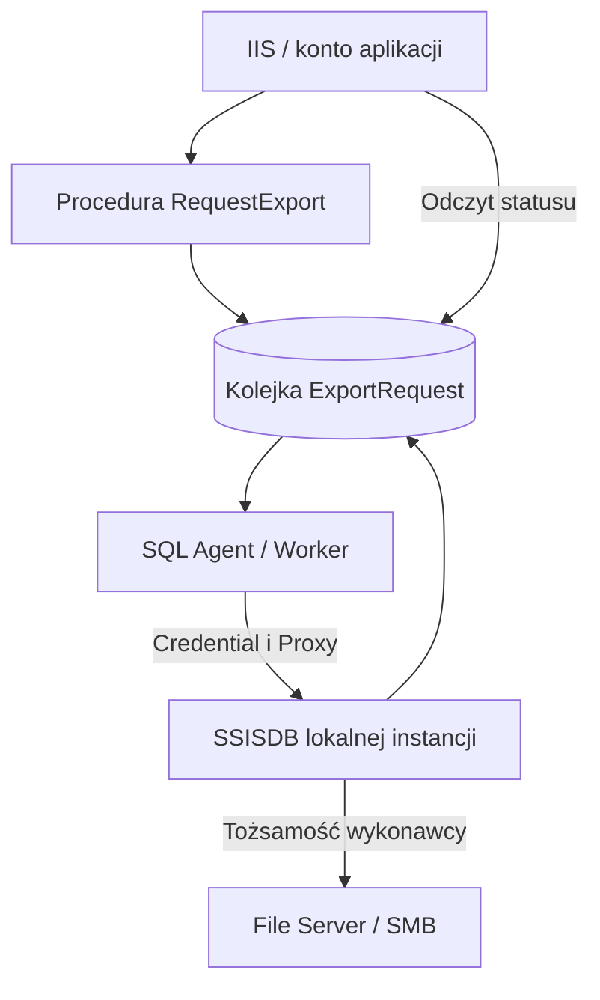

# SQL Server i SSIS bez Unconstrained Delegation

**Wersja:** 1.1 | **Data:** 2026-11-26 | **Status:** projekt techniczny i runbook do walidacji  
**Zakres:** SQL Server 2022, SSISDB, SQL Server Agent, Active Directory, SMB, WSFC/FCI.

## 1. Cel i decyzja architektoniczna

Moim celem jest uniezależnienie eksportów SSIS od nieograniczonej delegacji Kerberos na koncie usługi Database Engine. Nie wyłączam zabezpieczeń Windows ani nie zastępuję protokołu Kerberos protokołem NTLM. Zamiast tego rozdzielam tożsamość zlecającego od tożsamości wykonawcy.

Microsoft dokumentuje, że SSISDB nie obsługuje constrained delegation w opisanym scenariuszu double hop. Samo ustawienie KCD nie rozwiązuje więc problemu ISServerExec.exe. Nie traktuję RBCD jako potwierdzonego zamiennika w tym scenariuszu. [1]

## 2. Architektura

### Przed zmianą



### Po zmianie



W proponowanej przeze mnie architekturze worker działa niezależnie od sesji aplikacji. Proxy uzyskuje własny kontekst logowania; dostęp do SMB nie powinien wymagać delegowania konta aplikacji. Za warunek akceptacji przyjmuję potwierdzenie rzeczywistego konta po stronie SMB, a nie jedynie sprawdzenie ustawienia `Run as` w zadaniu Agenta. Zakładam, że Agent i katalog znajdują się na tej samej instancji FCI; zdalny katalog może ponownie wprowadzić double hop.

## 3. Inwentaryzacja przed zmianą

Przed rozpoczęciem migracji wykonuję następujące czynności:

- Identyfikuję wszystkie wywołania catalog.create_execution i catalog.start_execution, aplikacje, joby, pakiety, linked servers oraz zdalne źródła danych.
- Ustalam konto Database Engine, Agent, IIS i faktyczne konto procesu wykonawczego SSIS.
- Sprawdzam SPN VNN, port instancji, DNS, synchronizację czasu i stan AD.
- Zapisuję istniejące ustawienia delegacji oraz właścicieli jobów; nie publikuję danych infrastruktury ani sekretów.
- Ustalam kontrakt aplikacji: wynik synchroniczny czy identyfikator żądania. Kolejka nie jest przezroczystym zamiennikiem synchronicznego eksportu.
- Zabezpieczam kopie msdb, SSISDB, bazy kolejki oraz kluczy zgodnie z procedurą odtwarzania.

```sql
SELECT servicename, service_account, status_desc
FROM sys.dm_server_services;

SELECT SERVERPROPERTY('ServerName') AS InstanceName,
       SERVERPROPERTY('ComputerNamePhysicalNetBIOS') AS ActiveNode,
       SERVERPROPERTY('IsClustered') AS IsClustered;

-- W sesji aplikacji, nie w lokalnej sesji administratora:
SELECT ORIGINAL_LOGIN() AS OriginalLogin,
       SUSER_SNAME() AS EffectiveLogin,
       auth_scheme, net_transport
FROM sys.dm_exec_connections
WHERE session_id = @@SPID;

SELECT j.name, s.step_id, s.step_name, s.subsystem,
       p.name AS ProxyName
FROM msdb.dbo.sysjobs AS j
JOIN msdb.dbo.sysjobsteps AS s ON s.job_id = j.job_id
LEFT JOIN msdb.dbo.sysproxies AS p ON p.proxy_id = s.proxy_id
WHERE s.subsystem = 'SSIS';
```

```powershell
# RSAT ActiveDirectory; polecenia tylko odczytowe.
Get-ADServiceAccount -Identity 'sqlserver' -Properties TrustedForDelegation,ServicePrincipalName,msDS-AllowedToDelegateTo |
    Select-Object Name,TrustedForDelegation,ServicePrincipalName,msDS-AllowedToDelegateTo
setspn -Q MSSQLSvc/sql-vnn.example.test:1433
```

W przykładach posługuję się fikcyjnymi nazwami i portami. W przypadku zwykłego konta domenowego korzystam z `Get-ADUser`. Nie utożsamiam konta gMSA z obiektem VNN ani z kontem komputera węzła klastra.

## 4. Model uprawnień

Stosuję zasadę najmniejszych niezbędnych uprawnień i rozdzielam role zgodnie z poniższą tabelą.

| Zasób | Konto aplikacji | Konto wykonawcy |
|---|---|---|
| Procedura zgłoszenia i statusu | EXECUTE | według potrzeb |
| Tabele kolejki | bez bezpośredniego dostępu | przez procedury worker |
| Projekt SSISDB | brak | READ i EXECUTE; niezbędne środowisko READ |
| SMB i NTFS | brak | minimalne prawa do katalogu eksportu |
| sysadmin | nie | nie |
| Proxy Agent | brak | przypisanie do kroku joba przez DBA |

Jako konto wykonawcy wybieram dedykowane zwykłe konto domenowe, np. `EXAMPLE\svc_ssis_export`. Credential z hasłem nie jest automatycznie zamiennikiem gMSA. Uzgadniam prawa logowania wymagane przez Agenta oraz zasady GPO na każdym węźle, rotację hasła i ograniczenie logowania interaktywnego. Nie nadaję uprawnień administratora domeny ani administratora lokalnego. Uprawnienia Share i NTFS muszą jednocześnie umożliwiać wymagane operacje; prawo usuwania nadaję tylko wtedy, gdy jest niezbędne.

## 5. Credential i Proxy

Poniższy skrypt wykonuję jako DBA w kontrolowanej sesji. Nie zapisuję rzeczywistego sekretu w repozytorium, historii konsoli ani logach. Skrypt jest przeznaczony do jednorazowego wykonania; przed ponownym uruchomieniem sprawdzam istniejące obiekty.

```sql
USE master;
GO
CREATE CREDENTIAL [SSIS_Export_Credential]
WITH IDENTITY = N'EXAMPLE\svc_ssis_export',
     SECRET = N'<SECRET_FROM_VAULT>';
GO
CREATE LOGIN [EXAMPLE\svc_ssis_export] FROM WINDOWS;
GO
USE msdb;
GO
EXEC dbo.sp_add_proxy
    @proxy_name = N'SSIS_Export_Proxy',
    @credential_name = N'SSIS_Export_Credential',
    @enabled = 1;
EXEC dbo.sp_grant_proxy_to_subsystem
    @proxy_name = N'SSIS_Export_Proxy',
    @subsystem_name = N'Dts';
GO
USE SSISDB;
GO
CREATE USER [EXAMPLE\svc_ssis_export]
FOR LOGIN [EXAMPLE\svc_ssis_export];
GO
```

W SSMS przechodzę do: Integration Services Catalogs > SSISDB > folder > Projects > projekt > Properties > Permissions. Nadaję uprawnienia READ i EXECUTE na konkretnym projekcie oraz READ na wymaganym środowisku. Nie przypisuję roli `ssis_admin`. Właściciel joba niebędący sysadmin musi mieć odpowiednie uprawnienia Agent oraz dostęp do proxy (sp_grant_login_to_proxy). Nie udostępniam proxy aplikacji.

## 6. SQL Agent

Konfiguruję zadanie Agenta zgodnie z poniższą tabelą.

| Ustawienie | Wartość |
|---|---|
| Job | SSIS_Export_Worker |
| Step type | SQL Server Integration Services Package |
| Run as | SSIS_Export_Proxy |
| Package source | SSIS Catalog |
| Server | lokalna instancja FCI (właściwy VNN/instancja) |
| Package | właściwy pakiet worker |
| Schedule | np. co minutę; częstotliwość dobieram do SLA |
| Retry | kontrolowany na poziomie żądania |

Projektuję pakiet worker tak, aby pobierał żądania z kolejki i raportował wyniki. Samo utworzenie zadania Agenta nie implementuje kolejki. Alternatywnie mogę uruchomić lokalnego workera w dedykowanym kontekście Windows, wykorzystującego API katalogu i oczekującego na zakończenie wykonania. Jeśli wybieram krok CmdExec lub PowerShell zamiast SSIS, nadaję osobne uprawnienie do właściwego podsystemu. Nie zakładam, że krok T-SQL korzysta z proxy.

## 7. Referencyjny model kolejki

Kolejkę umieszczam w dedykowanej bazie aplikacyjnej. Nie tworzę własnych tabel w SSISDB. Przed wdrożeniem dostosowuję i testuję procedury oraz kontrakt pakietu. Poniżej przedstawiam szkielet integracyjny, a nie gotowy pakiet DTSX.

```sql
CREATE TABLE dbo.ExportRequest
(
    RequestId bigint IDENTITY PRIMARY KEY,
    ClientRequestId uniqueidentifier NOT NULL UNIQUE,
    RequestedBy sysname NOT NULL,
    CreatedUtc datetime2(3) NOT NULL DEFAULT SYSUTCDATETIME(),
    Status varchar(12) NOT NULL DEFAULT 'Pending',
    AttemptCount int NOT NULL DEFAULT 0,
    NextAttemptUtc datetime2(3) NOT NULL DEFAULT SYSUTCDATETIME(),
    StartedUtc datetime2(3) NULL,
    FinishedUtc datetime2(3) NULL,
    ExecutionId bigint NULL,
    ClaimToken uniqueidentifier NULL,
    LastError nvarchar(2048) NULL,
    CONSTRAINT CK_ExportRequest_Status CHECK
      (Status IN ('Pending','Running','Succeeded','Failed'))
);
CREATE INDEX IX_ExportRequest_Queue
ON dbo.ExportRequest(Status, NextAttemptUtc, RequestId);
GO
CREATE OR ALTER PROCEDURE dbo.usp_RequestExport
    @ClientRequestId uniqueidentifier
AS
BEGIN
    SET NOCOUNT ON;
    SET XACT_ABORT ON;
    BEGIN TRAN;
    DECLARE @id bigint;
    SELECT @id = RequestId
    FROM dbo.ExportRequest WITH (UPDLOCK,HOLDLOCK)
    WHERE ClientRequestId = @ClientRequestId
      AND RequestedBy = ORIGINAL_LOGIN();
    IF @id IS NULL
    BEGIN
        INSERT dbo.ExportRequest(ClientRequestId, RequestedBy)
        VALUES (@ClientRequestId, ORIGINAL_LOGIN());
        SET @id = CONVERT(bigint, SCOPE_IDENTITY());
    END;
    COMMIT;
    SELECT @id AS RequestId;
END;
GO
CREATE OR ALTER PROCEDURE dbo.usp_ClaimExport
AS
BEGIN
    SET NOCOUNT ON;
    ;WITH NextRequest AS
    (
        SELECT TOP (1) *
        FROM dbo.ExportRequest WITH (UPDLOCK, READPAST, READCOMMITTEDLOCK)
        WHERE Status = 'Pending'
          AND NextAttemptUtc <= SYSUTCDATETIME()
        ORDER BY NextAttemptUtc, RequestId
    )
    UPDATE NextRequest
    SET Status = 'Running', StartedUtc = SYSUTCDATETIME(),
        AttemptCount = AttemptCount + 1, ClaimToken = NEWID()
    OUTPUT inserted.RequestId, inserted.ClaimToken,
           inserted.AttemptCount;
END;
GO
CREATE OR ALTER PROCEDURE dbo.usp_CompleteExport
    @RequestId bigint,
    @ClaimToken uniqueidentifier,
    @Succeeded bit,
    @Retryable bit = 0,
    @ExecutionId bigint = NULL,
    @Error nvarchar(2048) = NULL
AS
BEGIN
    SET NOCOUNT ON;
    UPDATE dbo.ExportRequest
    SET Status = CASE WHEN @Succeeded = 1 THEN 'Succeeded'
                      WHEN @Retryable = 1 AND AttemptCount < 3 THEN 'Pending'
                      ELSE 'Failed' END,
        NextAttemptUtc = DATEADD(minute, 5, SYSUTCDATETIME()),
        FinishedUtc = CASE WHEN @Succeeded = 0 AND @Retryable = 1
                                AND AttemptCount < 3 THEN NULL
                           ELSE SYSUTCDATETIME() END,
        ExecutionId = @ExecutionId,
        LastError = CASE WHEN @Succeeded = 1 THEN NULL ELSE @Error END,
        ClaimToken = NULL
    WHERE RequestId = @RequestId AND ClaimToken = @ClaimToken
      AND Status = 'Running';
    IF @@ROWCOUNT <> 1 THROW 50001, 'Invalid or stale claim.', 1;
END;
GO
CREATE OR ALTER PROCEDURE dbo.usp_GetExportStatus
    @RequestId bigint
AS
BEGIN
    SET NOCOUNT ON;
    SELECT RequestId, Status, CreatedUtc, FinishedUtc
    FROM dbo.ExportRequest
    WHERE RequestId = @RequestId AND RequestedBy = ORIGINAL_LOGIN();
END;
GO
```

Nadaję uprawnienie EXECUTE na procedurach odpowiednim użytkownikom bazy. Aplikacji udostępniam wyłącznie RequestExport i GetExportStatus. Przy współdzielonym loginie IIS izolacja użytkowników końcowych wymaga dodatkowego autoryzowanego identyfikatora biznesowego. Nie przyjmuję dowolnych ścieżek UNC od klienta. Parametry eksportu waliduję i zapisuję w kolejce.

W logice workera najpierw pobieram żądanie, następnie możliwie wcześnie zapisuję identyfikator wykonania SSIS, wykonuję eksport, publikuję wynik i zamykam żądanie. Nie utrzymuję transakcji SQL przez cały czas eksportu. Stosuję deterministyczne nazwy plików, zapis do pliku tymczasowego i publikację po zakończeniu. Ponowienia projektuję jako operacje idempotentne. Nie ma gwarancji exactly-once między SQL i SMB. Po awarii nie ponawiam automatycznie żądań o statusie Running bez sprawdzenia aktywnego wykonania i pliku. Produkcyjny mechanizm odzyskiwania wymaga lease/heartbeat albo ręcznej rekoncyliacji. ClaimToken zapobiega zatwierdzeniu starego claimu, ale nie blokuje starego procesu przed zapisem pliku.

## 8. Diagnostyka

Diagnostykę rozpoczynam od sprawdzenia historii wykonań SSISDB, komunikatów i stanu kolejki.

```sql
SELECT TOP (50) execution_id, folder_name, project_name, package_name,
       executed_as_name, caller_name, status, start_time, end_time
FROM SSISDB.catalog.executions
ORDER BY execution_id DESC;

-- Podstawić rzeczywisty identyfikator wykonania.
DECLARE @execution_id bigint = 123;
SELECT message_time, message_type, message
FROM SSISDB.catalog.operation_messages
WHERE operation_id = @execution_id
ORDER BY message_time, operation_message_id;

SELECT Status, COUNT_BIG(*) AS Requests,
       MIN(CreatedUtc) AS OldestUtc
FROM dbo.ExportRequest
GROUP BY Status;
```

Na serwerze plików korzystam z Get-SmbSession i Get-SmbOpenFile oraz sprawdzam zdarzenia audytu Windows 4624 (typ logowania 3) i 5140/5145, jeśli odpowiedni audyt jest włączony. Koreluję czas, klienta, ścieżkę i konto. Wynik executed_as_name w SSISDB sam w sobie nie dowodzi tożsamości SMB. Przy błędzie Access Denied sprawdzam oba zestawy ACL, rzeczywisty token, konto proxy, prawa logowania, DNS i łączność TCP 445. Nie obniżam poziomu zabezpieczeń SMB.

## 9. FCI i plan wdrożenia

W środowisku klastrowym przyjmuję następującą kolejność działań:

1. Zatwierdzam zakres z właścicielami aplikacji, AD i bezpieczeństwa.
2. Wdrażam kolejkę, proxy i worker równolegle do istniejącego mechanizmu.
3. Testuję połączenia lokalne i z aplikacji; potwierdzam konto SMB.
4. Przełączam aplikację na nowy kontrakt; czekam na zakończenie dotychczasowych wykonań.
5. Weryfikuję inne zależności delegacji (w szczególności linked servers).
6. W uzgodnionym oknie zmian zlecam administratorowi AD wyłączenie delegacji tylko na zidentyfikowanym koncie usługi Database Engine.
7. Uwzględniam replikację AD, ważność biletów i konieczność odnowienia sesji usług. Restart usługi planuję wyłącznie po analizie wpływu i zatwierdzeniu okna. Nie wymuszam failoveru produkcyjnego.
8. Ponawiam pełne testy i monitoruję backlog, błędy oraz czas eksportu.

Poniższe polecenie przekazuję administratorowi AD. Zmienia ono ustawienie bezpieczeństwa, dlatego nie wykonuję go bez zatwierdzenia:

```powershell
Set-ADAccountControl -Identity (Get-ADServiceAccount -Identity 'sqlserver') -TrustedForDelegation $false
Get-ADServiceAccount -Identity 'sqlserver' -Properties TrustedForDelegation |
    Select-Object Name,TrustedForDelegation
```

Na wszystkich węzłach FCI weryfikuję komponenty SSIS, wersje runtime i sterowników, prawa logowania, dostęp do UNC, parametry środowiskowe oraz brak zależności od lokalnych ścieżek. Test przełączenia wykonuję w labie lub podczas osobno zatwierdzonego okna. Zachowuję SPN VNN; wyłączenie delegacji nie wymaga usunięcia SPN.

## 10. Macierz testów i kryteria odbioru

| Test | Oczekiwany wynik |
|---|---|
| Zgłoszenie z IIS | identyfikator żądania, brak dostępu aplikacji do SSISDB/SMB |
| Powtórzenie ClientRequestId | ten sam RequestId dla tego samego loginu |
| Dwa workery | brak jednoczesnego claimu tego samego żądania |
| Poprawny eksport | poprawny plik i Succeeded |
| SMB audit | dedykowana tożsamość wykonawcy |
| Brak uprawnień do udziału | kontrolowany błąd i brak fałszywego sukcesu |
| Przerwa SMB | ograniczone retry, bez duplikatów |
| Awaria worker | wykrycie Running i rekoncyliacja |
| Delegacja wyłączona | eksport nadal działa po odnowieniu kontekstów |
| Inne aplikacje i linked servers | brak regresji |
| Drugi węzeł FCI w labie | zgodność konfiguracji i poprawne wykonanie |

Wszystkie wyniki dokumentuję, zapisując czas UTC, wersję, konto, execution ID, wynik i dowód wykonania. Tego planu nie przedstawiam jako potwierdzenia przeprowadzonych testów.

## 11. Rollback

Jeżeli zmiana nie spełni kryteriów odbioru, postępuję według następującego planu:

- Wstrzymuję przyjmowanie nowych żądań i harmonogram workera; nie przerywam aktywnych eksportów bez analizy.
- Uzgadniam statusy Running i istniejące pliki; zachowuję kolejkę i logi.
- Przywracam poprzednią wersję procedury/aplikacji wyłącznie gdy jest zgodna z aktualną polityką bezpieczeństwa.
- Jeżeli stary mechanizm wymaga nieograniczonej delegacji, jej ponowne włączenie jest osobną decyzją bezpieczeństwa, nie automatycznym rollbackiem. Preferuję kontrolowaną przerwę lub alternatywny eksport.
- Po akceptacji i ustabilizowaniu systemu usuwam zbędne proxy/credential oraz uprawnienia zgodnie z zależnościami; nie usuwam współdzielonych obiektów.
- Rejestruję każdą zmianę, potwierdzam stan AD i powtarzam testy.

## 12. Ograniczenia i źródła

Moje rozwiązanie opieram na architekturze Request → Queue → Worker. W tej dokumentacji nie przedstawiam ponownej weryfikacji rzeczywistego środowiska ani kodu wcześniejszego POC. Skrypty udostępniam jako przykłady do przeglądu i testów na SQL Server 2022, a nie jako potwierdzone wdrożenie. Przed wdrożeniem weryfikuję przede wszystkim kontekst wykonania ISServerExec i SMB, zgodność kontraktu aplikacji oraz mechanizm odzyskiwania po awarii.

1. [Microsoft Learn — SSIS Catalog, double-hop scenarios](https://learn.microsoft.com/en-us/sql/integration-services/catalog/ssis-catalog?view=sql-server-ver16#ssisdb-catalog-and-delegation-in-double-hop-scenarios)
2. [Microsoft Learn — SQL Server Agent Jobs for Packages](https://learn.microsoft.com/en-us/sql/integration-services/packages/sql-server-agent-jobs-for-packages)
3. [Microsoft Learn — Create a SQL Server Agent Proxy](https://learn.microsoft.com/en-us/sql/ssms/agent/create-a-sql-server-agent-proxy)
4. [Microsoft Learn — Windows prevents unconstrained delegation](https://learn.microsoft.com/en-us/troubleshoot/sql/database-engine/connect/windows-prevents-unconstrained-delegation)

**Zasada:** eliminuję konieczność przekazywania poświadczeń aplikacji, zamiast próbować obejść ograniczenie delegacji.
