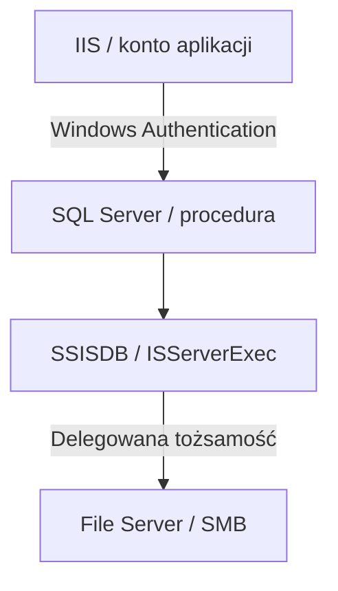
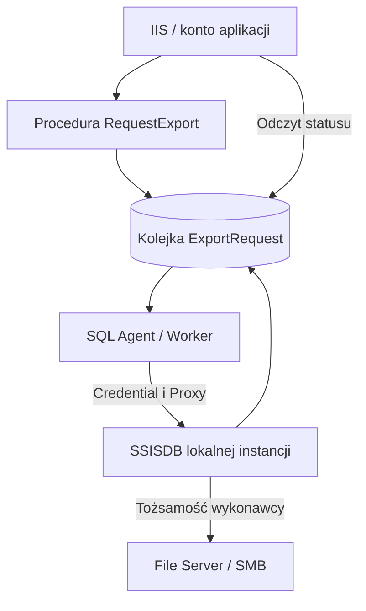

# SQL Server i SSIS bez Unconstrained Delegation

**Wersja:** 1.0 | **Data:** 2026-11-26 | **Status:** projekt techniczny i runbook do walidacji  
**Zakres:** SQL Server 2022, SSISDB, SQL Server Agent, Active Directory, SMB, WSFC/FCI.

## 1. Cel i decyzja architektoniczna

Usunąć zależność eksportów SSIS od nieograniczonej delegacji Kerberos na koncie usługi Database Engine. Nie wyłączamy zabezpieczeń Windows ani nie zastępujemy Kerberos przez NTLM. Rozdzielamy tożsamość zlecającego od tożsamości wykonawcy.

Microsoft dokumentuje, że SSISDB nie obsługuje constrained delegation w opisanym scenariuszu double hop. Samo ustawienie KCD nie rozwiązuje więc problemu ISServerExec.exe. RBCD nie jest tutaj traktowane jako potwierdzony zamiennik. [1]

## 2. Architektura

### Przed zmianą



### Po zmianie



Worker działa niezależnie od sesji aplikacji. Proxy uzyskuje własny kontekst logowania; dostęp do SMB nie powinien wymagać delegowania konta aplikacji. Warunkiem akceptacji jest potwierdzenie rzeczywistego konta po stronie SMB, nie tylko ustawienia Run as w jobie. Agent i katalog powinny znajdować się na tej samej instancji FCI; zdalny katalog może ponownie wprowadzić double hop.

## 3. Inwentaryzacja przed zmianą

- Zidentyfikować wszystkie wywołania catalog.create_execution i catalog.start_execution, aplikacje, joby, pakiety, linked servers oraz zdalne źródła danych.
- Ustalić konto Database Engine, Agent, IIS i faktyczne konto procesu wykonawczego SSIS.
- Sprawdzić SPN VNN, port instancji, DNS, synchronizację czasu i stan AD.
- Zapisać istniejące ustawienia delegacji oraz właścicieli jobów; nie publikować danych infrastruktury ani sekretów.
- Ustalić kontrakt aplikacji: wynik synchroniczny czy identyfikator żądania. Kolejka nie jest przezroczystym zamiennikiem synchronicznego eksportu.
- Zabezpieczyć kopie msdb, SSISDB, bazy kolejki oraz kluczy zgodnie z procedurą odtwarzania.

```sql
SELECT servicename, service_account, status_desc
FROM sys.dm_server_services;

SELECT SERVERPROPERTY('ServerName') AS InstanceName,
       SERVERPROPERTY('ComputerNamePhysicalNetBIOS') AS ActiveNode,
       SERVERPROPERTY('IsClustered') AS IsClustered;

-- W sesji aplikacji, nie w lokalnej sesji administratora:
SELECT ORIGINAL_LOGIN() AS OriginalLogin,
       SUSER_SNAME() AS EffectiveLogin,
       auth_scheme, net_transport
FROM sys.dm_exec_connections
WHERE session_id = @@SPID;

SELECT j.name, s.step_id, s.step_name, s.subsystem,
       p.name AS ProxyName
FROM msdb.dbo.sysjobs AS j
JOIN msdb.dbo.sysjobsteps AS s ON s.job_id = j.job_id
LEFT JOIN msdb.dbo.sysproxies AS p ON p.proxy_id = s.proxy_id
WHERE s.subsystem = 'SSIS';
```

```powershell
# RSAT ActiveDirectory; polecenia tylko odczytowe.
Get-ADServiceAccount -Identity 'sqlserver' -Properties TrustedForDelegation,ServicePrincipalName,msDS-AllowedToDelegateTo |
    Select-Object Name,TrustedForDelegation,ServicePrincipalName,msDS-AllowedToDelegateTo
setspn -Q MSSQLSvc/sql-vnn.example.test:1433
```

Nazwy i porty w przykładach są fikcyjne. Dla zwykłego konta domenowego użyć Get-ADUser; nie utożsamiać gMSA z obiektem VNN lub węzła.

## 4. Model uprawnień

| Zasób | Konto aplikacji | Konto wykonawcy |
|---|---|---|
| Procedura zgłoszenia i statusu | EXECUTE | według potrzeb |
| Tabele kolejki | bez bezpośredniego dostępu | przez procedury worker |
| Projekt SSISDB | brak | READ i EXECUTE; niezbędne środowisko READ |
| SMB i NTFS | brak | minimalne prawa do katalogu eksportu |
| sysadmin | nie | nie |
| Proxy Agent | brak | przypisanie do kroku joba przez DBA |

Konto wykonawcy: dedykowane zwykłe konto domenowe, np. EXAMPLE\\svc_ssis_export. Credential z hasłem nie jest automatycznie zamiennikiem gMSA. Uzgodnić prawa logowania wymagane przez Agent i GPO na każdym węźle, rotację hasła oraz ograniczenie logowania interaktywnego. Nie nadawać Domain Admin ani lokalnego Administratora. Uprawnienia Share i NTFS muszą jednocześnie umożliwiać wymagane operacje; usuwanie tylko jeśli jest potrzebne.

## 5. Credential i Proxy

Skrypt wykonywany przez DBA w kontrolowanej sesji; nie zapisywać rzeczywistego sekretu w repozytorium, historii konsoli czy logach. Przykłady są jednorazowe, przed ponowieniem sprawdzić istniejące obiekty.

```sql
USE master;
GO
CREATE CREDENTIAL [SSIS_Export_Credential]
WITH IDENTITY = N'EXAMPLE\svc_ssis_export',
     SECRET = N'<SECRET_FROM_VAULT>';
GO
CREATE LOGIN [EXAMPLE\svc_ssis_export] FROM WINDOWS;
GO
USE msdb;
GO
EXEC dbo.sp_add_proxy
    @proxy_name = N'SSIS_Export_Proxy',
    @credential_name = N'SSIS_Export_Credential',
    @enabled = 1;
EXEC dbo.sp_grant_proxy_to_subsystem
    @proxy_name = N'SSIS_Export_Proxy',
    @subsystem_name = N'Dts';
GO
USE SSISDB;
GO
CREATE USER [EXAMPLE\svc_ssis_export]
FOR LOGIN [EXAMPLE\svc_ssis_export];
GO
```

W SSMS: Integration Services Catalogs > SSISDB > folder > Projects > projekt > Properties > Permissions. Nadać READ i EXECUTE na konkretnym projekcie oraz READ na wymaganym środowisku. Nie nadawać ssis_admin. Właściciel joba niebędący sysadmin musi mieć odpowiednie uprawnienia Agent oraz dostęp do proxy (sp_grant_login_to_proxy). Nie udostępniać proxy aplikacji.

## 6. SQL Agent

| Ustawienie | Wartość |
|---|---|
| Job | SSIS_Export_Worker |
| Step type | SQL Server Integration Services Package |
| Run as | SSIS_Export_Proxy |
| Package source | SSIS Catalog |
| Server | lokalna instancja FCI (właściwy VNN/instancja) |
| Package | właściwy pakiet worker |
| Schedule | np. co minutę; dobrać do SLA |
| Retry | kontrolowany na poziomie żądania |

Pakiet worker musi pobierać żądania z kolejki i raportować wyniki; samo stworzenie joba nie implementuje kolejki. Wariant alternatywny: lokalny worker uruchamiany w dedykowanym kontekście Windows, który używa API katalogu i czeka na zakończenie. Jeśli stosowany jest krok CmdExec/PowerShell zamiast SSIS, potrzebuje osobnego uprawnienia do właściwego subsystemu. Nie zakładać, że T-SQL job step używa Proxy.

## 7. Referencyjny model kolejki

Przykład w dedykowanej bazie aplikacyjnej. Nie tworzyć własnych tabel w SSISDB. Procedury i kontrakt pakietu trzeba dostosować i przetestować; to szkielet integracyjny, nie gotowy pakiet DTSX.

```sql
CREATE TABLE dbo.ExportRequest
(
    RequestId bigint IDENTITY PRIMARY KEY,
    ClientRequestId uniqueidentifier NOT NULL UNIQUE,
    RequestedBy sysname NOT NULL,
    CreatedUtc datetime2(3) NOT NULL DEFAULT SYSUTCDATETIME(),
    Status varchar(12) NOT NULL DEFAULT 'Pending',
    AttemptCount int NOT NULL DEFAULT 0,
    NextAttemptUtc datetime2(3) NOT NULL DEFAULT SYSUTCDATETIME(),
    StartedUtc datetime2(3) NULL,
    FinishedUtc datetime2(3) NULL,
    ExecutionId bigint NULL,
    ClaimToken uniqueidentifier NULL,
    LastError nvarchar(2048) NULL,
    CONSTRAINT CK_ExportRequest_Status CHECK
      (Status IN ('Pending','Running','Succeeded','Failed'))
);
CREATE INDEX IX_ExportRequest_Queue
ON dbo.ExportRequest(Status, NextAttemptUtc, RequestId);
GO
CREATE OR ALTER PROCEDURE dbo.usp_RequestExport
    @ClientRequestId uniqueidentifier
AS
BEGIN
    SET NOCOUNT ON;
    SET XACT_ABORT ON;
    BEGIN TRAN;
    DECLARE @id bigint;
    SELECT @id = RequestId
    FROM dbo.ExportRequest WITH (UPDLOCK,HOLDLOCK)
    WHERE ClientRequestId = @ClientRequestId
      AND RequestedBy = ORIGINAL_LOGIN();
    IF @id IS NULL
    BEGIN
        INSERT dbo.ExportRequest(ClientRequestId, RequestedBy)
        VALUES (@ClientRequestId, ORIGINAL_LOGIN());
        SET @id = CONVERT(bigint, SCOPE_IDENTITY());
    END;
    COMMIT;
    SELECT @id AS RequestId;
END;
GO
CREATE OR ALTER PROCEDURE dbo.usp_ClaimExport
AS
BEGIN
    SET NOCOUNT ON;
    ;WITH NextRequest AS
    (
        SELECT TOP (1) *
        FROM dbo.ExportRequest WITH (UPDLOCK, READPAST, READCOMMITTEDLOCK)
        WHERE Status = 'Pending'
          AND NextAttemptUtc <= SYSUTCDATETIME()
        ORDER BY NextAttemptUtc, RequestId
    )
    UPDATE NextRequest
    SET Status = 'Running', StartedUtc = SYSUTCDATETIME(),
        AttemptCount = AttemptCount + 1, ClaimToken = NEWID()
    OUTPUT inserted.RequestId, inserted.ClaimToken,
           inserted.AttemptCount;
END;
GO
CREATE OR ALTER PROCEDURE dbo.usp_CompleteExport
    @RequestId bigint,
    @ClaimToken uniqueidentifier,
    @Succeeded bit,
    @Retryable bit = 0,
    @ExecutionId bigint = NULL,
    @Error nvarchar(2048) = NULL
AS
BEGIN
    SET NOCOUNT ON;
    UPDATE dbo.ExportRequest
    SET Status = CASE WHEN @Succeeded = 1 THEN 'Succeeded'
                      WHEN @Retryable = 1 AND AttemptCount < 3 THEN 'Pending'
                      ELSE 'Failed' END,
        NextAttemptUtc = DATEADD(minute, 5, SYSUTCDATETIME()),
        FinishedUtc = CASE WHEN @Succeeded = 0 AND @Retryable = 1
                                AND AttemptCount < 3 THEN NULL
                           ELSE SYSUTCDATETIME() END,
        ExecutionId = @ExecutionId,
        LastError = CASE WHEN @Succeeded = 1 THEN NULL ELSE @Error END,
        ClaimToken = NULL
    WHERE RequestId = @RequestId AND ClaimToken = @ClaimToken
      AND Status = 'Running';
    IF @@ROWCOUNT <> 1 THROW 50001, 'Invalid or stale claim.', 1;
END;
GO
CREATE OR ALTER PROCEDURE dbo.usp_GetExportStatus
    @RequestId bigint
AS
BEGIN
    SET NOCOUNT ON;
    SELECT RequestId, Status, CreatedUtc, FinishedUtc
    FROM dbo.ExportRequest
    WHERE RequestId = @RequestId AND RequestedBy = ORIGINAL_LOGIN();
END;
GO
```

Nadać EXECUTE na procedurach odpowiednim użytkownikom bazy; aplikacji tylko RequestExport i GetExportStatus. Przy współdzielonym loginie IIS izolacja użytkowników końcowych wymaga dodatkowego autoryzowanego identyfikatora biznesowego. Nie przyjmować dowolnych ścieżek UNC od klienta. Parametry eksportu walidować i utrwalać w kolejce.

Worker: pobierz żądanie, zapisz identyfikator wykonania SSIS możliwie wcześnie, wykonaj eksport, opublikuj wynik, zakończ żądanie. Nie utrzymuj transakcji SQL przez cały eksport. Stosuj deterministyczne nazwy plików, plik tymczasowy i publikację po zakończeniu; retry musi być idempotentne. Nie ma gwarancji exactly-once między SQL i SMB. Po awarii Running nie wolno automatycznie ponawiać bez sprawdzenia aktywnego wykonania i pliku. Produkcyjny mechanizm odzyskiwania wymaga lease/heartbeat albo ręcznej rekoncyliacji. ClaimToken zapobiega zatwierdzeniu starego claimu, ale nie blokuje starego procesu przed zapisem pliku.

## 8. Diagnostyka

```sql
SELECT TOP (50) execution_id, folder_name, project_name, package_name,
       executed_as_name, caller_name, status, start_time, end_time
FROM SSISDB.catalog.executions
ORDER BY execution_id DESC;

-- Podstawić rzeczywisty identyfikator wykonania.
DECLARE @execution_id bigint = 123;
SELECT message_time, message_type, message
FROM SSISDB.catalog.operation_messages
WHERE operation_id = @execution_id
ORDER BY message_time, operation_message_id;

SELECT Status, COUNT_BIG(*) AS Requests,
       MIN(CreatedUtc) AS OldestUtc
FROM dbo.ExportRequest
GROUP BY Status;
```

Na serwerze plików sprawdzić Get-SmbSession / Get-SmbOpenFile oraz audyt Windows 4624 (typ logowania 3), 5140/5145 jeśli włączony. Korelować czas, klienta, ścieżkę i konto. Wynik executed_as_name w SSISDB sam w sobie nie dowodzi tożsamości SMB. Przy błędzie Access Denied sprawdzić oba ACL, rzeczywisty token, konto proxy, prawa logowania, DNS i łączność TCP 445. Nie obniżać zabezpieczeń SMB.

## 9. FCI i plan wdrożenia

1. Zatwierdzić zakres z właścicielami aplikacji, AD i bezpieczeństwa.
2. Wdrożyć kolejkę, proxy i worker równolegle do istniejącego mechanizmu.
3. Przetestować połączenia lokalne i z aplikacji; potwierdzić konto SMB.
4. Przełączyć aplikację na nowy kontrakt; opróżnić stare wykonania.
5. Zweryfikować inne zależności delegacji (w szczególności linked servers).
6. W uzgodnionym oknie AD wyłączyć delegację tylko na zidentyfikowanym koncie usługi Database Engine.
7. Uwzględnić replikację AD, ważność biletów i konieczność odnowienia sesji usług. Restart usługi wyłącznie po analizie wpływu i zatwierdzeniu okna. Nie wymuszać failoveru produkcyjnego.
8. Ponowić pełne testy i monitorować backlog, błędy oraz czas eksportu.

Przykład dla administratora AD — polecenie zmienia ustawienie bezpieczeństwa, nie uruchamiać bez zatwierdzenia:

```powershell
Set-ADAccountControl -Identity (Get-ADServiceAccount -Identity 'sqlserver') -TrustedForDelegation $false
Get-ADServiceAccount -Identity 'sqlserver' -Properties TrustedForDelegation |
    Select-Object Name,TrustedForDelegation
```

Na wszystkich węzłach FCI zweryfikować komponenty SSIS, wersje runtime i sterowników, prawa logowania, dostęp do UNC, parametry środowiskowe oraz brak zależności od lokalnych ścieżek. Test przełączenia wykonać w labie lub podczas osobno zatwierdzonego okna. Zachować SPN VNN; wyłączenie delegacji nie wymaga usunięcia SPN.

## 10. Macierz testów i kryteria odbioru

| Test | Oczekiwany wynik |
|---|---|
| Zgłoszenie z IIS | identyfikator żądania, brak dostępu aplikacji do SSISDB/SMB |
| Powtórzenie ClientRequestId | ten sam RequestId dla tego samego loginu |
| Dwa workery | brak jednoczesnego claimu tego samego żądania |
| Poprawny eksport | poprawny plik i Succeeded |
| SMB audit | dedykowana tożsamość wykonawcy |
| Brak uprawnień do udziału | kontrolowany błąd i brak fałszywego sukcesu |
| Przerwa SMB | ograniczone retry, bez duplikatów |
| Awaria worker | wykrycie Running i rekoncyliacja |
| Delegacja wyłączona | eksport nadal działa po odnowieniu kontekstów |
| Inne aplikacje i linked servers | brak regresji |
| Drugi węzeł FCI w labie | zgodność konfiguracji i poprawne wykonanie |

Wszystkie wyniki należy udokumentować (UTC, wersja, konto, execution ID, wynik, dowód). Dokument nie stanowi potwierdzenia wykonania tych testów.

## 11. Rollback

- Wstrzymać przyjmowanie nowych żądań i harmonogram workera; nie przerywać aktywnych eksportów bez analizy.
- Uzgodnić statusy Running i istniejące pliki; zachować kolejkę i logi.
- Przywrócić poprzednią wersję procedury/aplikacji wyłącznie gdy jest zgodna z aktualną polityką bezpieczeństwa.
- Jeżeli stary mechanizm wymaga nieograniczonej delegacji, jej ponowne włączenie jest osobną decyzją bezpieczeństwa, nie automatycznym rollbackiem. Preferować kontrolowaną przerwę lub alternatywny eksport.
- Po akceptacji i ustabilizowaniu systemu usunąć zbędne proxy/credential oraz uprawnienia zgodnie z zależnościami; nie usuwać współdzielonych obiektów.
- Rejestrować każdą zmianę, potwierdzić stan AD i powtórzyć testy.

## 12. Ograniczenia i źródła

Wariant bazuje na architekturze Request → Queue → Worker. Nie zweryfikowano tutaj rzeczywistego środowiska ani kodu wcześniejszego POC. Skrypty są przykładami do review i testów na SQL Server 2022, a nie potwierdzonym wdrożeniem. W szczególności należy zweryfikować kontekst wykonania ISServerExec i SMB, kompatybilność kontraktu aplikacji oraz odzyskiwanie po awarii.

1. [Microsoft Learn — SSIS Catalog, double-hop scenarios](https://learn.microsoft.com/en-us/sql/integration-services/catalog/ssis-catalog?view=sql-server-ver16#ssisdb-catalog-and-delegation-in-double-hop-scenarios)
2. [Microsoft Learn — SQL Server Agent Jobs for Packages](https://learn.microsoft.com/en-us/sql/integration-services/packages/sql-server-agent-jobs-for-packages)
3. [Microsoft Learn — Create a SQL Server Agent Proxy](https://learn.microsoft.com/en-us/sql/ssms/agent/create-a-sql-server-agent-proxy)
4. [Microsoft Learn — Windows prevents unconstrained delegation](https://learn.microsoft.com/en-us/troubleshoot/sql/database-engine/connect/windows-prevents-unconstrained-delegation)

**Zasada:** eliminujemy konieczność przekazywania poświadczeń aplikacji, zamiast próbować obejść ograniczenie delegacji.
