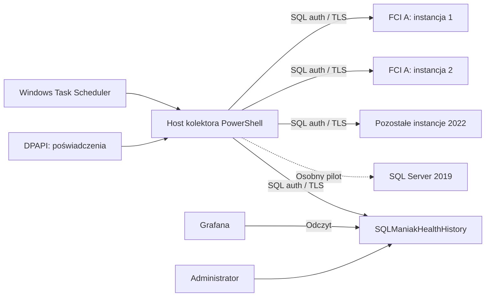
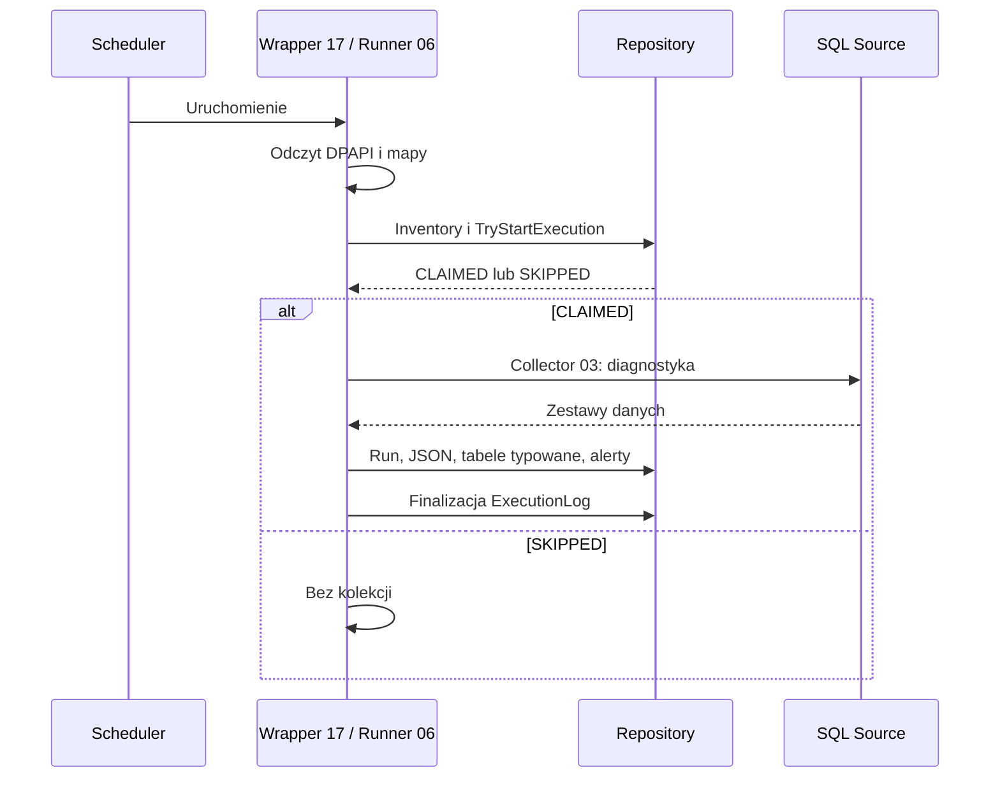
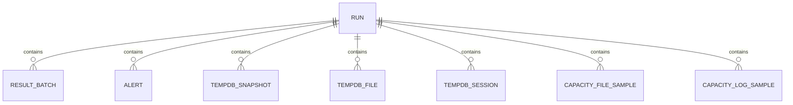

# SQLManiak Daily Health Check v1.7
## Architektura techniczna i model bezpieczeństwa

Data: 25.11.2026. Kod bazowy: master po PR #142 (5cbb7e9). Status: kandydat do pilotażu produkcyjnego SQL Server 2022. Dokument uzupełnia [instrukcję instalacji i eksploatacji](PRODUCTION_DEPLOYMENT.md).

## 1. Model centralny

Jeden host Windows uruchamia PowerShell 7.5 i inicjuje połączenia SQL do źródeł oraz repozytorium. Nie instaluje się osobnego procesu kolektora na każdej instancji. Dane są pobierane przez centralny proces (pull), nie wysyłane przez agentów na źródłach. Repozytorium nie potrzebuje linked serverów do monitorowanych instancji.



Strzałki oznaczają inicjatora połączenia. Wyniki źródłowe wracają do PowerShell, który zapisuje je centralnie.

## 2. Konta i granice zaufania

| Tożsamość | Gdzie | Zadanie |
|---|---|---|
| Dedykowane konto Windows | Host kolektora | Uruchamia zadanie i odczytuje DPAPI |
| dhc_source_collector | Każda monitorowana instancja | Pobiera diagnostykę |
| dhc_repository_collector | Centralny SQL Server | Zapisuje pomiary i obsługuje claim |
| dhc_grafana_reader | Centralny SQL Server | Odczytuje wybrane obiekty raportowe |
| DBA | Repozytorium i źródła | Instalacja, uprawnienia, audyt, retencja |

Przy ośmiu instancjach SQL powstaje osiem niezależnych loginów SQL o tej samej nazwie dhc_source_collector. Zalecane osobne silne hasło dla każdego endpointu. Nie jest to jeden login domenowy. Instalator 37 dodatkowo tworzy dwa loginy na repozytorium, również gdy Grafana nie jest używana; alternatywny 34 pozwala pominąć konto Grafana. Gdy repozytorium też jest monitorowanym źródłem, otrzymuje oddzielny login źródłowy.

Wrapper 17 korzysta z SQL Authentication. Bezpośredni kolektor 03 może używać Windows Authentication bez SqlCredential, ale pełna ścieżka harmonogramu i uprawnień Windows wymaga osobnego projektu. Nie zmieniać automatycznie trybu Windows-only na Mixed Mode.

## 3. FCI i sieć

Login jest obiektem instancji w master, dlatego tworzymy go raz na instancję FCI, nie na każdy fizyczny węzeł. Każda odrębna instancja na klastrze ma własne loginy. Używać stabilnego VNN/nazwy instancji lub zatwierdzonego endpointu TCP. Nie wykonywać failover na potrzeby instalacji.

| Inicjator | Cel | Tożsamość SQL |
|---|---|---|
| Kolektor | Źródło, rzeczywisty port TCP | dhc_source_collector |
| Kolektor | Repozytorium, rzeczywisty port TCP | dhc_repository_collector |
| Grafana | Repozytorium | dhc_grafana_reader |
| Źródło | Remote SQL (tylko opcjonalna sonda) | Istniejące mapowanie linked servera |

TLS z zaufanym certyfikatem i właściwą nazwą endpointu; TrustServerCertificate nie jest zalecanym ustawieniem produkcyjnym. Firewall ograniczyć do zatwierdzonych hostów i portów. XE wymaga ścieżki dostępnej dla konta usługi SQL na każdym możliwym właścicielu FCI.

## 4. Uprawnienia źródła

Na każdym SQL Server 2022 uruchomić 38_Configure-DHC-Source-AllInOne.sql jako DBA, ustawiając @ExpectedServer i hasło w prywatnej kopii. Istniejące hasło nie zostanie zmienione.

| Grant | Cel |
|---|---|
| VIEW SERVER PERFORMANCE STATE | Diagnostyka wydajności |
| VIEW SERVER SECURITY STATE | Metadane bezpieczeństwa |
| VIEW ANY ERROR LOG | Odczyt ERRORLOG |
| VIEW ANY DEFINITION | Widoczność metadanych, w tym sys.master_files |
| msdb.SQLAgentReaderRole | Widoczność zadań Agent |
| msdb.dhc_agent_history_reader | SELECT na sysjobs, sysjobhistory, sysjobschedules, sysjobactivity, sysschedules; EXECUTE agent_datetime |

Bez sysadmin, db_owner i db_datareader. ALTER TRACE pozostaje wyłączony; instalator nie usuwa wcześniejszych grantów. SQLAgentReaderRole nie gwarantuje formalnie konta całkowicie read-only (dziedziczy uprawnienia SQLAgentUserRole); sprawdzić efektywne prawa. VIEW ANY DEFINITION wymaga akceptacji bezpieczeństwa. Dostęp do każdej bazy sprawdzać osobno; Capacity raportuje LIMITED_ACCESS i PARTIAL w razie braku dostępu do widocznej bazy ONLINE. Nie dodawać automatycznie użytkownika do model. Instalator 38 nie obsługuje SQL Server 2019; potrzebna odrębna matryca grantów.

## 5. Mapa poświadczeń

Kolektor wybiera PSCredential według dokładnego endpointu z dhc.MonitoredServer. Hasła nie trafiają do inventory. Skrypt 16 zapisuje poświadczenia w plikach DPAPI pod LOCALAPPDATA, a 17 je odczytuje. Konto i host Windows muszą być takie same podczas zapisu i odczytu. Ograniczyć ACL oraz zabezpieczyć host.

```powershell
$repoServer = 'REPLACE_WITH_REPOSITORY_ENDPOINT'
$repoCredential = Get-Credential -UserName dhc_repository_collector -Message 'Repository'
$map = @{
    'FCI-A\SQL01' = (Get-Credential -UserName dhc_source_collector -Message 'FCI-A SQL01')
    'FCI-A\SQL02' = (Get-Credential -UserName dhc_source_collector -Message 'FCI-A SQL02')
    'FCI-B\SQL01' = (Get-Credential -UserName dhc_source_collector -Message 'FCI-B SQL01')
}
$dir = Join-Path $env:LOCALAPPDATA 'SQLManiakDHC-PROD'
.\16_Save-DHC-SchedulerConfig.ps1 -RepositoryServer $repoServer -RepositoryCredential $repoCredential -SqlCredentialByServer $map -SecretsDirectory $dir
$config = Join-Path $dir 'scheduler.json'
.\21_Test-SchedulerIdentity.ps1 -ConfigPath $config -Environment PROD -CheckSqlPreview
```

Zastąpić symboliczne endpointy rzeczywistymi wartościami i dodać wszystkie zatwierdzone źródła. Wykonać pod rzeczywistą tożsamością zadania. Nie drukować connection string, nie commitować sekretów. Skrypt 16 odmawia nadpisania istniejącego katalogu; rotacja przez nowy katalog, weryfikację i przełączenie zadania. Zmiana hosta lub konta wymaga ponownego zapisu poświadczeń. DPAPI nie zastępuje zabezpieczeń hosta.

## 6. Przebieg kolekcji



Runner przetwarza źródła sekwencyjnie; domyślny interwał inventory to 1440 minut. Proponowany wyzwalacz co 5–15 minut, do uzgodnienia. Atomowy claim chroni przed równoległym wykonaniem tej samej instancji przez współpracujące runnery. Bezpośredni 03 omija claim. RUNNING po awarii wymaga weryfikacji DBA, nie automatycznego czyszczenia.

## 7. Moduły i model danych

| Moduł | Dane |
|---|---|
| Main DHC | 17 oczekiwanych zestawów: usługi, ERRORLOG, JOBS, dyski, backupy, log, blocking, autogrowth, harmonogramy, podsumowania |
| TempDB | Dane/log, version store, pliki i sesje |
| Capacity | Alokacja, użycie, limity, log reuse, polityka wolumenów |
| Linked Server | Metadane, widoczne mapowania, dowody ERRORLOG, opcjonalna sonda |
| XE | Automatyczny dodatni wzrost plików, ograniczona historia rollover |

Obowiązkowy [SQLManiak_Daily_Health_Check_v1_5_CSV.sql](SQLManiak_Daily_Health_Check_v1_5_CSV.sql) jest dostarczany w katalogu v1.7 w niezmienionej, audytowanej wersji. SHA256: `8978B06A630F24D672EDD78721B1B8A4A84DD6CCC724B9B87DF4DBB847DA67B8`. Lokalny `.gitattributes` wyłącza normalizację zakończeń linii. Kolektor adaptuje znane sekcje w pamięci i wymusza SaveHistory=0. Nie zapisuje historii na źródle; obecność starego schematu hc może jednak zmienić liczbę zestawów wynikowych. Przed pilotażem sprawdzić brak legacy hc.Sample zgodnie z [audytem](SOURCE_SQL_AUDIT.md).



MonitoredServer to inventory. ExecutionLog to niezależna historia prób; RunId jest logicznym odwołaniem bez FK. VolumeCapacityPolicy zarządza DBA. Linked Server wykorzystuje ResultBatch. Grafana odczytuje wybrane obiekty centralne, nie łączy się ze źródłami. JSON i ERRORLOG mogą zawierać wrażliwe dane; ograniczyć odczyt oraz zabezpieczyć backupy.

## 8. Odporność i utrzymanie

COMPLETE oznacza zakończoną kolekcję, nie brak alertów. PARTIAL zachowuje dostępne dane oraz błędy modułów. FAILED w ExecutionLog może wystąpić bez zapisanego Run. Savepoint chroni wcześniejsze wyniki przy obsługiwalnej awarii modułu. Aktywna sonda linked servera wymaga jawnej allowlisty w 03/06 i istniejącego mapowania; 17 nie przekazuje allowlisty. Pasywne dane nie dowodzą dostępności, a ANONYMOUS LOGON nie dowodzi źródła awarii.

PurgeRuns domyślnie DryRun, usuwa partiami wyłącznie zakończone przebiegi z FinishedUTC. ExecutionLog nie jest objęty retencją. Brak automatycznej retencji. Monitorować repozytorium, wzrost JSON, log oraz backup/restore. Awaria kolektora powoduje lukę pomiarową; nie ma automatycznego HA schedulera.

## 9. Mapa wdrożenia

| Miejsce | Skrypty |
|---|---|
| Repozytorium SQL 2022+ | 37 lub 34 i jego zależności |
| Każde źródło SQL 2022 | 38, 39, 40 |
| Host Windows | 03,06,02,43,47,48,16,17,21 oraz dołączony SQL v1.5 |
| DBA | 10,45,50; inventory i polityka woluminów |
| Grafana | Dashboardy w dashboards/sqlserver, osobny reader |

Najpierw ręczny pilot jednej instancji 2022, potem weryfikacja kompletności, tożsamości i harmonogramu. Dopiero następnie kolejne źródła. Nie uruchamiać sond aktywnych ani automatycznej retencji na starcie. Szczegółowe komendy i rollback: [PRODUCTION_DEPLOYMENT.md](PRODUCTION_DEPLOYMENT.md).

## 10. Podstawa i ograniczenia

Źródła: [38](38_Configure-DHC-Source-AllInOne.sql), [16](16_Save-DHC-SchedulerConfig.ps1), [17](17_Invoke-DHC-Scheduled.ps1), [06](06_Run-DHC-MonitoredServers.ps1), [03](03_Run-DHC-v1_7.ps1), [37](37_Install-DHC-Repository-AllInOne.sql) i instrukcja produkcyjna. SQL Authentication potwierdzono w Docker SQL Server 2022. Windows FCI/Kerberos, SQL Server 2019, wydajność retencji i pełna kompatybilność raportów wymagają dalszej walidacji. Nazwy hostów, liczba instancji i interwały są przykładami. Dokument nie zmienia kodu wykonawczego ani produkcji.
