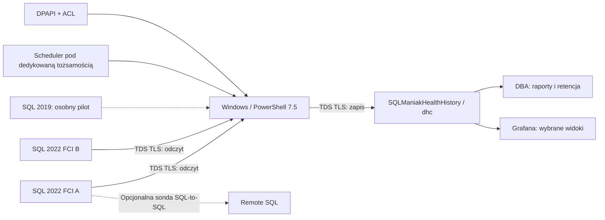

# SQLManiak Daily Health Check v1.7
## Architektura, instalacja i eksploatacja produkcyjna

**Wersja dokumentu:** 2026-11-25. **Status:** kandydat do pilotażu SQL Server 2022, nie certyfikacja produkcyjna. **Zakres:** czysta instalacja centralnego repozytorium oraz kolektora na Windows; źródła SQL Server 2022. SQL Server 2019 wymaga osobnego pilotażu i modelu uprawnień, SQL Server 2016 poza zakresem. Podstawą są skrypty z PR #141 i wyniki LAB z 25 listopada 2026.

## 1. Cel i granice systemu

DHC centralizuje wyniki kontroli administracyjnej. Nie zastępuje monitoringu ciągłego ani systemu alertów w czasie rzeczywistym. Nie wykonuje automatycznych napraw, KILL, shrink, rebuild, zmian linked serverów, backupów źródeł ani failover. Kolektor wykonuje diagnostykę i zapisuje dane centralnie. Instalator źródła i XE są odrębnymi, świadomymi zmianami administracyjnymi.

## 2. Architektura logiczna



Strzałki źródło–kolektor oznaczają przepływ wyników; połączenia inicjuje host kolektora. Sondy aktywne inicjuje źródłowa instancja SQL za pośrednictwem istniejącego linked servera. Nie potrzeba połączeń zwrotnych z repozytorium do źródeł. Użyć stabilnego endpointu VNN/instancji FCI, nie nazwy fizycznego węzła. Porty ustalić z rzeczywistej konfiguracji, w tym port repozytorium. TLS z poprawnym łańcuchem zaufania i nazwą certyfikatu odpowiadającą endpointowi. Nie otwierać portów Docker LAB na produkcji.

### Komponenty i odpowiedzialność

| Komponent | Funkcja |
|---|---|
| 03_Run-DHC-v1_7.ps1 | Jedna instancja, walidacja kontraktu, kolekcja i zapis |
| 06_Run-DHC-MonitoredServers.ps1 | Sekwencyjna obsługa aktywnych pozycji inventory, atomic claim i historia prób |
| 16_Save-DHC-SchedulerConfig.ps1 | Windows DPAPI, osobny sekret repo i mapa poświadczeń źródeł |
| 17_Invoke-DHC-Scheduled.ps1 | Odczyt konfiguracji i wywołanie runnera; domyślnie preview |
| 02 / 43 / 47 / 48 | Moduły TempDB, Capacity, Linked Server metadata, sonda |
| 37 / 38 / 39 / 40 | Instalacja repozytorium, kont źródeł, XE, walidacja |
| 34 / 35 | Alternatywna ścieżka instalacji PowerShell (nie łączyć bez potrzeby z AllInOne) |
| 10 / 45 / 50 | Kontrole repozytorium bez zmian danych |
| 21 / 24 | Audyt tożsamości schedulera i statyczny audyt zewnętrznego SQL |
| 36 | Opcjonalny odrębny czytelnik Grafana; 37 już zawiera jego konfigurację |

## 3. Model danych i zachowanie transakcyjne

| Obiekt dhc | Znaczenie |
|---|---|
| MonitoredServer | Endpoint, środowisko, IsEnabled, IntervalMinutes, CollectTempDB; bez sekretów |
| ExecutionLog | Trwała próba wykonania, w tym awaria przed kontaktem ze źródłem |
| Run | Zapis kolekcji, UTC, status, liczby głównych wyników, ErrorText |
| ResultBatch | JSON kolumn i wierszy, RunId/ResultIndex/BatchNo; domyślnie 100 wierszy na batch |
| Alert | WARNING/CRITICAL, obszar, obiekt, szczegóły |
| TempDBSnapshot / TempDBFile / TempDBSession | Próbka plików, logu, version store, sesji |
| CapacityFileSample / CapacityLogSample | Alokacja, wykorzystanie, wzrost, log reuse, limity |
| VolumeCapacityPolicy | Polityka rozbudowy i rezerwy woluminu zarządzana przez DBA |
| TryStartExecution | Atomowa, współpracująca blokada per ServerId i kontrola terminu |
| PurgeRuns | Ręczna retencja chroniąca aktywne przebiegi |

`ExecutionLog.RunId` nie ma FK do Run. PurgeRuns usuwa Run i siedem tabel zależnych, ale **nie czyści ExecutionLog**; odwołanie historyczne może wskazywać już usunięty pomiar. Retencja ExecutionLog wymaga odrębnego projektu i decyzji.

Główne wyniki mają stabilne indeksy 1–17; nieznane lub duplikaty trafiają pod ujemne indeksy i powodują anomalię kontraktu. Linked Server używa 300–303 i 310+. SourceResultSets dotyczy głównego SQL; StoredResultSets obejmuje logiczne zestawy, również puste. RowsStored liczy wiersze JSON, nie sumę wpisów we wszystkich tabelach. COMPLETE oznacza ukończenie kolekcji, nie brak alertów ani zdrowie źródła. PARTIAL zachowuje dostępne dane i szczegóły błędów modułów. Fatalny błąd głównego SQL może wycofać Run; runner 06 zapisuje wtedy FAILED w ExecutionLog. Savepoint chroni wcześniejsze wyniki przy obsługiwalnej awarii modułu. `-Force` omija termin, ale nie aktywne RUNNING ani wyłączenie inventory. Bezpośredni 03 omija claim runnera; nie uruchamiać równolegle z harmonogramem.

## 4. Wymagania i bezpieczeństwo

- Centralny SQL Server 2022+, przestrzeń danych/logu, uzgodniony recovery model, backup i odtwarzanie. Instalator 37 tworzy bazę z domyślną konfiguracją instancji; jeśli standard wymaga określonych plików, utworzyć pustą bazę z uzgodnionymi parametrami wcześniej.
- Windows host kolektora, PowerShell 7.5 zalecany (skrypty wymagają co najmniej 7.2), moduł SqlServer i Microsoft.Data.SqlClient. Sprawdzić wersje i przypiąć zatwierdzony zestaw na hoście.
- **Zewnętrzny plik SQLManiak_Daily_Health_Check_v1_5_CSV.sql jest obowiązkowy i nie znajduje się w Git.** Skopiować zatwierdzoną wersję obok 03, 06 i 17. Ręczne 03/06 przyjmują -SqlFile, wrapper 17 korzysta z domyślnej ścieżki. Utrwalić SHA256. In-memory rewrite wymusza SaveHistory=0, adaptuje ERRORLOG, autogrowth XE i zależność JOBS. Nie stosować dowolnego innego skryptu v1.5 bez sprawdzenia kontraktu.
- SQL loginy: dhc_repository_collector na repo, dhc_source_collector na każdym źródle, dhc_grafana_reader tylko do raportowania. 37 tworzy dwa konta repozytorium, także gdy Grafana nie będzie używana. Można wybrać 34 zamiast 37, jeśli wymagane jest pominięcie konta Grafana.
- Żaden kolektor nie ma być sysadmin, db_owner ani db_datawriter. Role nie cofają historycznych nadmiarowych grantów; audyt efektywnych uprawnień obowiązkowy.
- Źródło 2022: VIEW SERVER PERFORMANCE STATE, VIEW SERVER SECURITY STATE, VIEW ANY ERROR LOG, VIEW ANY DEFINITION; msdb SQLAgentReaderRole oraz dhc_agent_history_reader (SELECT sysjobs, sysjobhistory, sysjobschedules, sysjobactivity, sysschedules; EXECUTE agent_datetime). VIEW ANY DEFINITION ujawnia metadane całej instancji; zatwierdzić z bezpieczeństwem. ALTER TRACE pozostaje 0. Dostęp do każdej bazy i wymaganych DMV sprawdzić indywidualnie; brak dostępu do ONLINE może skutkować PARTIAL. Nie dodawać użytkownika do model automatycznie (dziedziczenie przez nowe bazy).
- SQL authentication wymaga odpowiedniego trybu uwierzytelniania i zatwierdzonych kont. Nie zmieniać trybu auth automatycznie. Windows integrated identity wymaga odrębnego projektu grantów i schedulera; dostarczone 16/17 używają SQL credentials.
- DPAPI działa tylko pod tą samą tożsamością Windows i na tym samym komputerze. Ograniczyć ACL do konta wykonawczego i uzgodnionych administratorów. Nie kopiować DPAPI pomiędzy węzłami FCI. Osobny stabilny host kolektora jest zalecany. Nie umieszczać sekretów w repo, logach, argumentach zadania lub transkrypcji.
- Dane JSON i ERRORLOG mogą zawierać wrażliwe metadane, loginy i tekst zapytań. Ograniczyć odczyt, szyfrować transport i backupy według polityki organizacji.

## 5. Przygotowanie hosta kolektora

```powershell
git switch master
git pull --ff-only origin master
git log -1 --oneline
Set-Location .\tools\SQLManiakDailyHealthCheck\v1.7
Import-Module SqlServer -ErrorAction Stop
Add-Type -AssemblyName Microsoft.Data.SqlClient -ErrorAction Stop
$PSVersionTable.PSVersion
Get-Module SqlServer | Select-Object Name,Version
Get-FileHash .\SQLManiak_Daily_Health_Check_v1_5_CSV.sql -Algorithm SHA256
.\24_Audit-SourceSqlPermissions.ps1
```

Jeżeli modułu brakuje, zainstalować zatwierdzoną wersję z dozwolonego repozytorium pakietów (Install-Module SqlServer -Scope CurrentUser); konto wykonawcze musi mieć do niej dostęp. Skopiować kod do wersjonowanego katalogu wdrożeniowego z ACL i zachować poprzednią wersję. Nie uruchamiać harmonogramu bez pilotażu.

## 6. Czysta instalacja centralnego repozytorium

Wstrzymać jedynie istniejący DHC, nie usługi SQL/Agent. Sprawdzić aktywne kolekcje, backupy, właściciela i dokładny serwer. Jeżeli stara baza jest rzeczywiście pusta i administrator zatwierdził odtworzenie, można ją usunąć **ręcznie** w oddzielnym kroku. Nie dołączać DROP DATABASE do instalatora. Nawet pusta historia może zawierać inventory, polityki woluminów i konfigurację; zachować je lub potwierdzić, że są zbędne. Nie wymuszać SINGLE_USER ani rollback obcych sesji. Backup lub możliwość odtworzenia konfiguracji zgodnie z procedurą zmian.

```sql
SELECT @@SERVERNAME AS InstanceName, SERVERPROPERTY('ProductVersion') AS Version;
SELECT name,state_desc,recovery_model_desc FROM sys.databases
WHERE name=N'SQLManiakHealthHistory';
-- Jeżeli istnieje, sprawdzić wszystkie tabele i aktywne sesje przed decyzją o DROP.
```

Rekomendowana ścieżka SQL-only: 37_Install-DHC-Repository-AllInOne.sql. W prywatnej kopii poza Git ustawić @ExpectedServer na dokładne @@SERVERNAME oraz dwa różne hasła >=16 znaków. Istniejące loginy nie są resetowane, nawet po DROP DATABASE. Zachować ich prawidłowe hasła lub przeprowadzić osobną rotację. Nie używać sa do kolekcji.

**Ważne:** 37 zawiera wiele partii GO. Sam THROW w pierwszej partii nie gwarantuje zatrzymania następnych w zwykłym SSMS. Użyć klienta zatrzymującego wykonanie po błędzie, np. Invoke-Sqlcmd z -AbortOnError -ErrorAction Stop, na zatwierdzonym endpoincie. Nie kontynuować po błędzie. Analogiczna zasada dla pozostałych instalatorów.

```powershell
$repoServer = 'REPLACE_WITH_REPOSITORY_ENDPOINT'
$admin = Get-Credential
Invoke-Sqlcmd -ServerInstance $repoServer -Database master -Credential $admin `
  -InputFile 'C:\SecureDeployment\37-private.sql' -AbortOnError -ErrorAction Stop -QueryTimeout 300
```

Przykład zakłada SQL admin credential; dla Windows auth pominąć -Credential i uruchomić jako uprawniony DBA. Nie używać -TrustServerCertificate na produkcji bez zaakceptowanego wyjątku. Zakończenie musi zawierać DHC REPOSITORY INSTALL VALIDATED. Przejrzeć także błędy, obiekty, role, backup i ustawienia plików.

Alternatywa: 34_Install-DHC-Repository.ps1 (preview, potem -Apply), z parametrami -ServerInstance, -AdministratorCredential, -CollectorLogin, opcjonalnie -NewCollectorCredential. Instaluje kolejno 01,04,08,09,12,14,42,44,49,20; 36 oddzielnie w razie potrzeby. Nie uruchamiać 01 samotnie na repo z Capacity: nadpisałby pełną procedurę retencji wariantem bazowym.

```sql
USE SQLManiakHealthHistory;
SELECT name,type_desc FROM sys.objects WHERE schema_id=SCHEMA_ID(N'dhc') ORDER BY type_desc,name;
SELECT r.name AS RoleName,u.name AS UserName
FROM sys.database_role_members m JOIN sys.database_principals r ON r.principal_id=m.role_principal_id
JOIN sys.database_principals u ON u.principal_id=m.member_principal_id
WHERE r.name IN(N'dhc_collector',N'dhc_portal_reader');
EXECUTE AS USER=N'dhc_repository_collector';
SELECT IS_ROLEMEMBER('db_owner') AS IsOwner,
 HAS_PERMS_BY_NAME('dhc.Run','OBJECT','INSERT') AS CanInsert,
 HAS_PERMS_BY_NAME('dhc.Run','OBJECT','DELETE') AS CanDelete,
 HAS_PERMS_BY_NAME('dhc.PurgeRuns','OBJECT','EXECUTE') AS CanPurge;
REVERT;
```

Oczekiwane 0/1/0/0. Sprawdzić także efektywne uprawnienia na poziomie serwera i logowanie rzeczywistym kontem. Nie przechodzić dalej przy niespójności.

## 7. Instalacja na jednym źródle SQL Server 2022 FCI

1. Ustalić VNN/endpoint i @@SERVERNAME, wersję, aktywnego właściciela, TLS, konto usługi SQL i lokalizację XEL. Uruchamiać raz na instancję, nie per node.
2. 38_Configure-DHC-Source-AllInOne.sql: prywatna kopia, @ExpectedServer, @Password dla nowego loginu, @GrantAlterTrace=0. Alternatywnie 35 PowerShell w preview i -Apply. Nie używać obu rutynowo.
3. 39_Install-DHC-AutogrowthXE-AllInOne.sql: @ExpectedServer, zaakceptowana ścieżka @XelFileName (domyślnie katalog ERRORLOG), 32 MB × 8 plików nominalnie, @StartNow=1 i @StartupState=1 dopiero po akceptacji. Sesja SQLManiak_Autogrowth filtruje automatyczny dodatni wzrost pliku; ALLOW_SINGLE_EVENT_LOSS i rollover ograniczają kompletność historii. Istniejącej sesji nie nadpisuje. Na FCI sprawdzić dostępność ścieżki i prawa konta usługi na każdym możliwym właścicielu; nie inicjować failover na potrzeby instalacji.
4. 40_Validate-DHC-Source-XE-Deployment.sql: ustawić @ExpectedServer, zweryfikować stan sesji, widoczne pliki, granty i odczyt XEL pod tożsamością kolektora. Puste zdarzenia mogą oznaczać brak zdarzeń lub ograniczoną historię; nie wymuszać autogrow na produkcji.
5. Sprawdzić rzeczywisty dostęp do baz użytkownika i DMV. Nie przyznawać szerokiego CONNECT ANY DATABASE ani praw do model bez oceny. Szczegółowa procedura XE i rollback: [41_PRODUCTION_XE_DEPLOYMENT.md](41_PRODUCTION_XE_DEPLOYMENT.md).

SQL Server 2019: instalatory 34/35/37/38/39/40 ograniczone do 2022+ w swoim zakresie; nie usuwać warunków wersji. Repozytorium pozostaje 2022. Źródło 2019 wymaga osobnej matrycy grantów (m.in. VIEW SERVER STATE zamiast nowszych praw), audytu zewnętrznego SQL, XE i pełnego testu runtime. Nie włączać 2019 do PROD inventory przed zatwierdzeniem.

## 8. Inventory i ręczny pilot

```sql
USE SQLManiakHealthHistory;
INSERT dhc.MonitoredServer(ServerInstance,DisplayName,Environment,MonitorGroup,IsEnabled,IntervalMinutes,CollectTempDB)
VALUES(N'REPLACE_WITH_FCI_ENDPOINT',N'Pilot SQL 2022',N'PROD',N'FCI',0,1440,1);
SELECT * FROM dhc.MonitoredServer;
```

Wartość endpointu ma być identyczna w inventory, mapie poświadczeń i polityce woluminu. Zastąpić placeholdery przed wykonaniem. Włączyć wyłącznie zatwierdzony pilot (IsEnabled=1 dla dokładnego endpointu). Inne instancje pozostawić wyłączone. 1440 minut to przyjęty startowy interwał do uzgodnienia, nie wymóg.

```powershell
$source = 'REPLACE_WITH_FCI_ENDPOINT'
$repoServer = 'REPLACE_WITH_REPOSITORY_ENDPOINT'
$repoCredential = Get-Credential -UserName dhc_repository_collector -Message 'Repository'
$sourceCredential = Get-Credential -UserName dhc_source_collector -Message 'Pilot source'
$b = [Microsoft.Data.SqlClient.SqlConnectionStringBuilder]::new()
$b['Data Source'] = $repoServer
$b['Initial Catalog'] = 'SQLManiakHealthHistory'
$b['User ID'] = $repoCredential.UserName
$b['Password'] = $repoCredential.GetNetworkCredential().Password
$b['Encrypt'] = 'True'
$b['Trust Server Certificate'] = $false
$b['Persist Security Info'] = $false
$b['Connect Timeout'] = 5
$map = @{}
$map[$source] = $sourceCredential
try {
  .\06_Run-DHC-MonitoredServers.ps1 -RepositoryConnectionString $b.ConnectionString `
    -SqlCredentialByServer $map -Environment PROD -ServerInstance $source
  # Po sprawdzeniu preview i zatwierdzeniu pilota:
  .\06_Run-DHC-MonitoredServers.ps1 -RepositoryConnectionString $b.ConnectionString `
    -SqlCredentialByServer $map -Environment PROD -ServerInstance $source `
    -Execute -ConnectionTimeout 5 -QueryTimeout 300
} finally { $b.Clear() }
```

Bez -Execute runner tylko pokazuje stan. Bez -Force respektuje termin. Bez -LinkedServerProbeByInstance działa pasywnie. Capacity i TempDB domyślnie aktywne (TempDB zależy też od inventory). Nie drukować connection string. Po pilotażu przeanalizować wynik jako DBA:

```sql
USE SQLManiakHealthHistory;
SELECT TOP(20) * FROM dhc.ExecutionLog ORDER BY StartedUTC DESC;
SELECT TOP(20) * FROM dhc.Run ORDER BY StartedUTC DESC;
SELECT TOP(100) * FROM dhc.vDailyAlerts ORDER BY StartedUTC DESC;
SELECT * FROM dhc.vMonitoringStatus;
SELECT * FROM dhc.vMonitoringSummary;
SELECT TOP(100) * FROM dhc.vTempDBTrend ORDER BY StartedUTC DESC;
SELECT TOP(100) * FROM dhc.vLinkedServerHistory ORDER BY StartedUTC DESC;
```

Uruchomić 10,45,50. Oczekiwane 17 głównych zestawów zgodnie z kontraktem; liczba wierszy zależna od instancji. W pasywnym LAB było 27 zapisanych zestawów, aktywna jedna sonda 28; to punkty odniesienia, nie uniwersalna gwarancja. Brak MODULE ERRORS i kompletność metadanych porównać z odczytem DBA. Alert CRITICAL nie musi oznaczać awarii kolektora; PARTIAL wymaga analizy. Nie rozszerzać pilotażu przy brakujących danych lub błędach uprawnień.

## 9. Harmonogram produkcyjny Windows

Dostarczone stare skrypty rejestrujące zadania były wyłącznie LAB; nie wdrażać ich na produkcji. Wybrać stabilny host, dedykowane konto Windows z zatwierdzonym logon type i prawami do katalogów. Utworzyć DPAPI pod **tym samym** kontem na **tym samym** hoście. Mapa ma obejmować każdy aktywny endpoint.

```powershell
# W sesji rzeczywistego konta wykonawczego; $map i $repoCredential jak wyżej.
$dir = Join-Path $env:LOCALAPPDATA 'SQLManiakDHC-PROD'
.\16_Save-DHC-SchedulerConfig.ps1 -RepositoryServer $repoServer `
  -RepositoryCredential $repoCredential -SqlCredentialByServer $map -SecretsDirectory $dir
# Ograniczyć ACL i sprawdzić brak dostępu innych użytkowników.
$config = Join-Path $dir 'scheduler.json'
.\21_Test-SchedulerIdentity.ps1 -ConfigPath $config -Environment PROD -CheckSqlPreview
.\17_Invoke-DHC-Scheduled.ps1 -ConfigPath $config -Environment PROD
# Po akceptacji, test pod tożsamością zadania:
.\17_Invoke-DHC-Scheduled.ps1 -ConfigPath $config -Environment PROD -Execute
```

16 odmawia nadpisania istniejącego katalogu. Rotacja: utworzyć nowy katalog, zweryfikować, przełączyć konfigurację zadania, po akceptacji bezpiecznie wycofać stary. Nie przenosić plików na inny host.

Utworzyć Windows Task Scheduler ręcznie według polityki organizacji, początkowo Disabled. Program: zatwierdzona pełna ścieżka do pwsh.exe. Argumenty:
```text
-NoProfile -NonInteractive -File "C:\SQLManiakDHC\17_Invoke-DHC-Scheduled.ps1" -ConfigPath "C:\PRIVATE\scheduler.json" -Environment PROD -Execute
```
Podstawić faktyczne ścieżki (config pod LOCALAPPDATA konta). Start in: katalog wdrożenia. Ustawić uruchamianie niezależnie od logowania użytkownika, jeżeli zatwierdzona tożsamość to obsługuje, oraz Do not start a new instance (IgnoreNew). Nie ustawiać limitu czasu krótszego niż uzgodnione najgorsze wykonanie wszystkich instancji; brutalne zatrzymanie może pozostawić RUNNING. Proponowana częstotliwość wyzwalacza 5–15 min; runner sam ocenia IntervalMinutes. Zadanie nie jest automatycznie tworzone przez skrypty. Wrapper 17 zgłasza FAILED jako błąd procesu, PARTIAL należy monitorować w bazie. Wrapper nie udostępnia parametru allowlist sond: aktywne sondy uruchamiać przez 03/06, a ich automatyzację wdrożyć dopiero po odrębnej decyzji.

## 10. Capacity, Linked Server i Grafana

Capacity: GiB = 1024 MiB. Polityka woluminu kluczowana przez dokładny ServerInstance i VolumeMountPoint. Uzupełnić zatwierdzone maksima i rezerwy; brak polityki oznacza INSUFFICIENT DATA. Nie kopiować przykładowych limitów G/P/R na inne serwery. Prognoza używa USED, nie alokacji, potrzebuje minimum pięciu COMPLETE pomiarów przez minimum siedem dni. Wolna przestrzeń deduplikowana wewnątrz filegroup, nie jest rezerwacją i może być współdzielona między bazami. Rekomendacje nie są poleceniami do automatycznego wykonania.

Linked Server: pasywnie 47 zbiera metadane i widoczne mapowania; brak widocznego mapowania nie dowodzi braku mapowania. ANONYMOUS LOGON z ERRORLOG nie dowodzi związku z konkretnym linked serverem. Opcjonalny 48 dopuszcza wyłącznie SQL-to-SQL, jawną allowlistę i efektywne skończone connect/query timeout <=15/30 s, data access ON; provider może przekroczyć timeout. Nie zmieniać konfiguracji tylko po to, by sonda przeszła. Nie testować produkcyjnych niedostępności przez wyłączanie usług. Po zatwierdzeniu ręczna sonda:
```powershell
# Parametr dodatkowy do ręcznego 06, z rzeczywistą nazwą:
$probes = @{}
$probes[$source] = @('REPLACE_WITH_APPROVED_LINK')
# -LinkedServerProbeByInstance $probes
```
vLinkedServerStateChanges rozdziela historie według źródła, linked servera i CollectorLogin. PASS→FAILED = OUTAGE, FAILED→PASS = RECOVERY; SKIPPED przerywa ciągłość, pasywny przebieg nie jest pomiarem dostępności. Nie oznacza dokładnego czasu awarii. SQL auth w LAB nie potwierdza Kerberos double hop.

Grafana: użyć osobnego dhc_grafana_reader, wyłącznie wybrane widoki z 36, bez raw JSON i nowych uprawnień do linked login metadata. Dashboard MVP znajduje się poza katalogiem v1.7: [instrukcja portalu](../../../dashboards/sqlserver/SQLManiak-DHC-Portal-MVP.md). Nie zakładać, że wszystkie nowe widoki są dostępne w Grafana.

## 11. Retencja i utrzymanie

```sql
USE SQLManiakHealthHistory;
DECLARE @Cutoff datetime2(3)=DATEADD(DAY,-90,SYSUTCDATETIME());
EXEC dhc.PurgeRuns @OlderThanUTC=@Cutoff,@DryRun=1,@BatchSize=100;
```

90 dni to przykład do uzgodnienia, nie przyjęta polityka banku. Domyślnie DryRun=1, liczy wszystkich kandydatów. DryRun=0 usuwa jedną partię maksymalnie 100 (zakres 1–1000) najstarszych zakończonych przebiegów, wraz z siedmioma tabelami zależnymi; bez RUNNING i bez FinishedUTC. XACT_ABORT, TRY/CATCH, rollback całej partii, brak zewnętrznej transakcji. Nie uruchamiać automatycznie przed benchmarkiem logu, blokad i backupu. Limit dotyczy przebiegów, nie liczby rekordów szczegółowych. Ręcznie powtarzać zatwierdzoną operację po sprawdzeniu wyników. ExecutionLog pozostaje poza retencją.

Codziennie: sprawdzić ostatnie próby, świeżość COMPLETE, PARTIAL, FAILED i zaległe RUNNING. Nie kasować/odblokowywać RUNNING bez potwierdzenia, że proces nie działa. Obserwować rozmiar i autogrowth repozytorium, log, czas kolekcji i przyrost JSON. Regularnie sprawdzać backup oraz odtworzenie. Nie włączać produkcyjnych sond bez oddzielnego testu.

## 12. Odbiór, rollback i ograniczenia

Bramki: repozytorium i role poprawne; pierwszy 2022 COMPLETE lub wyjaśniony PARTIAL, brak niewyjaśnionych luk; test identycznej tożsamości schedulera; sukces ręcznego wykonania; zatwierdzenie przed włączeniem zadania; kolejna instancja dopiero po weryfikacji poprzedniej. Zalecane minimum siedem dni obserwacji przed rozszerzeniem Capacity forecast. SQL 2019 dopiero osobny pilot.

Rollback: wyłączyć wyłącznie zadanie DHC, potwierdzić zakończenie procesów, wrócić do poprzedniego katalogu kodu i konfiguracji (zgodność schematu zweryfikować). Nie usuwać świeżych danych automatycznie. Jeśli konieczne, odtworzyć repozytorium z backupu według procedury DBA. Zmiany źródłowe cofane oddzielnie, tylko obiekty i granty utworzone przez to wdrożenie, po sprawdzeniu innych konsumentów. XE można zatrzymać po zatwierdzeniu; nie usuwać istniejącej sesji lub plików bez potwierdzenia właściciela i potrzeby zachowania dowodów. Nie wykonywać failover.

LAB 25.11.2026: 22 oryginalne przebiegi (18 COMPLETE, 4 PARTIAL); SQL auth, awaria DNS, brak mapowania 7416, błędne hasło 18456, login disabled 18470, recovery, LP źródła/repo, brakujące tabele, Capacity ograniczony dostęp, zależność JOBS i stabilne indeksy. Retencja: DryRun 7/22 bez usunięć; pięć syntetycznych przebiegów, trzy kandydaty, dwa chronione; partia 2; rollback wyjątku 51999 zachował 8/8 rekordów, XACT_STATE=0 i @@TRANCOUNT=0; retry usunął 8/8; końcowo 22/22, 0 testowych, trigger nie istnieje. To wyniki operatora, nie automatyczny CI. Szczegółowe RunId i starsze testy w [archiwum README](https://github.com/marcinpytlik/SQLManiak/blob/archive/dhc-v1.7-lab-20261125/tools/SQLManiakDailyHealthCheck/v1.7/README.md).

Pozostałe ograniczenia: Windows FCI/Kerberos, pełna integracja 2019, aktualna regresja XE pod produkcyjną tożsamością, pozytywna próbka ANONYMOUS LOGON, SKIPPED, nieznane/duplikowane schematy wyników, kompatybilność wszystkich raportów, throughput i konkurencja retencji. Nie deklarować gotowości bez odbioru pilotażu. Nie ustalono przyczyny źródłowej wcześniejszego incydentu Kerberos.

## 13. Minimalny manifest produkcyjny i archiwum

**Runtime:** 02,03,06,16,17,21,24,43,47,48 oraz obowiązkowy zewnętrzny v1.5 SQL. **Instalacja SQL:** 37,38,39,40; 41 i 38 MD jako uzupełnienie. **Kontrole:** 10,45,50. **Alternatywny modularny instalator i definicje źródłowe:** 01,04,08,09,12,14,20,34,35,36,42,44,49. Nie usuwać tych definicji: 34 korzysta z nich bezpośrednio; są też podstawą utrzymania AllInOne. .gitignore pozostaje.

Z katalogu produkcyjnego usunięto 22 plików laboratoryjnych. Cała poprzednia wersja, Docker Compose, testy i stary README są dostępne w gałęzi [archive/dhc-v1.7-lab-20261125](https://github.com/marcinpytlik/SQLManiak/tree/archive/dhc-v1.7-lab-20261125/tools/SQLManiakDailyHealthCheck/v1.7), a także w niezmiennym commicie e06018c08d5e112e906d67ae8ba11ac7bbad1927. Testy regresyjne można odtwarzać z archiwum z zachowaniem właściwej wersji. Nie uruchamiać archiwalnych skryptów na produkcji.

- .env.example
- 05_Seed-DockerTarget.sql
- 07_Seed-DockerTarget2.sql
- 11_Test-NoData-Overdue.sql
- 13_Test-ConcurrentClaims.ps1
- 15_Test-RunningWatch.sql
- 18_Create-SqlAgent-Job_DISABLED.sql
- 19_Test-Scheduler-Due.ps1
- 22_New-RepositoryLabLogin.ps1
- 23_Test-RepositoryLabLogin.ps1
- 25_New-SourceLabLogins.ps1
- 26_Test-FullLeastPrivilege.ps1
- 27_Source-AutogrowthTraceRole-LAB.sql
- 28_Test-SourceObjectPermissions.ps1
- 29_Source-MsdbAgentHistoryRole-LAB.sql
- 30_Test-SecondSourceFullLeastPrivilege.ps1
- 31_Test-FinalDHCDataAudit.sql
- 32_Register-WindowsScheduledTask-LAB.ps1
- 33_Verify-WindowsScheduledTask-LAB.ps1
- DOCKER_LAB.md
- compose.yaml
- grafana-compose.yaml
